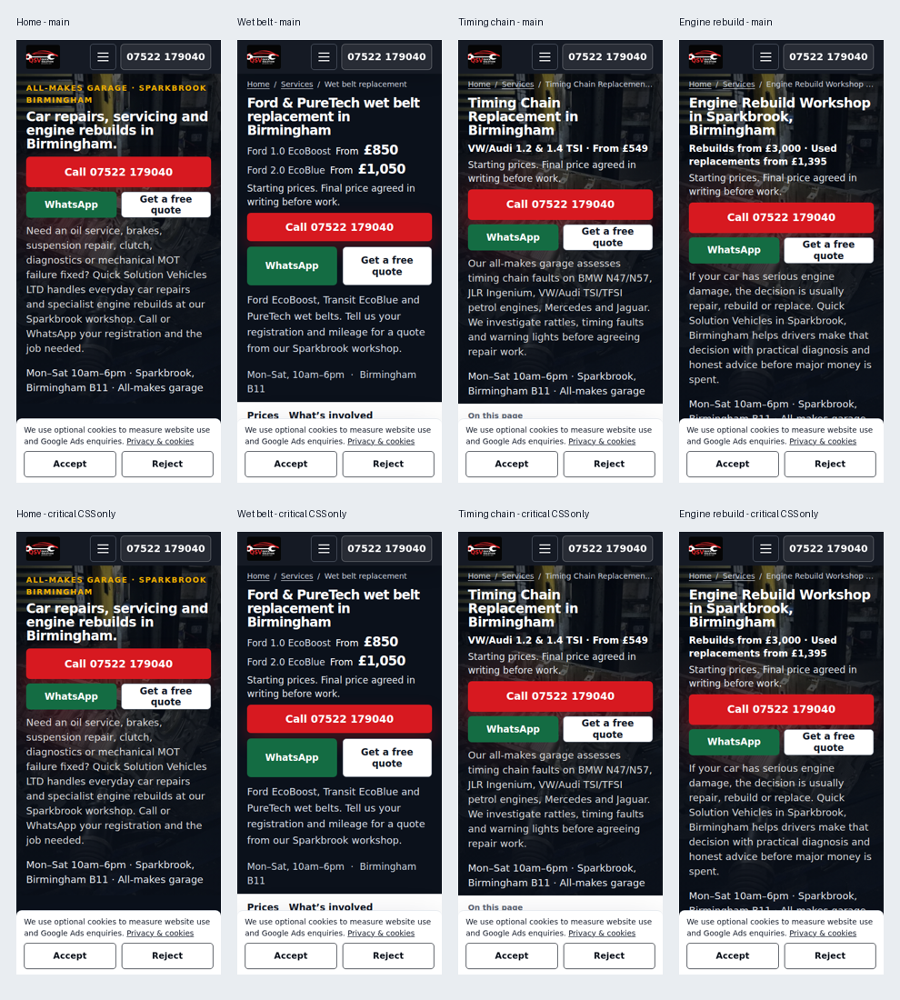

# Critical CSS performance review — 8 November 2026

**Draft: the LCP target is still unmet on home, timing chain and engine rebuild.** The implementation and preservation checks are complete, but this is not a claim that all requested speed targets have been achieved.

The build now generates first-screen CSS at 375 × 812 and 1350 × 940 for all 39 styled pages, using `critical` 7.2.1. That CSS is included in the HTML. Full stylesheets load asynchronously with the existing version queries and a no-JavaScript fallback. Hidden, open and focus styles for navigation, cookie controls and the mobile contact bar are retained in the first-screen CSS.

The flagged engine-image preloads are actually used: the photo is a CSS background and the measured LCP element on home, timing chain and engine rebuild. They must not be removed as unused. Preloads now follow the actual hero class, use the exact CSS background at each breakpoint, include matching responsive hints, and include the existing desktop background. The wet-belt hero has no image preload. No lazy image is preloaded. No photograph, image URL, alt text, dimensions, lazy-loading attribute or picture source list was changed.

## Lighthouse results

Three mobile runs per page per version; every value below is the median. Accessibility, Best Practices and SEO are **100 before and after on every page**. All after medians meet CLS ≤ 0.05 and TBT < 200 ms. Only wet belt meets LCP < 2.5 seconds.

| Page | Performance before → after | LCP before → after | CLS before → after | TBT before → after |
| --- | --- | --- | --- | --- |
| Home | 90 → 92 | 3.59 s → 2.95 s | 0.020 → 0.020 | 95 ms → 99 ms |
| Wet belt | 98 → 98 | 0.91 s → 0.70 s | 0.020 → 0.020 | 176 ms → 156 ms |
| Timing chain | 95 → 95 | 2.69 s → 2.68 s | 0.020 → 0.020 | 139 ms → 134 ms |
| Engine rebuild | 95 → 94 | 2.70 s → 2.68 s | 0.020 → 0.020 | 149 ms → 159 ms |

These are controlled local A/B results, not live PageSpeed Insights scores. Both builds were served with gzip and the same cache headers, using Lighthouse 13.6.0, Chromium 153.0.8010.0 and the default mobile preset with simulated throttling. The original main commit was `2f598df16d4558f301f0aba59821e5a9562f9743`.

The environment's browser cannot directly validate the managed HTTPS proxy's certificate. For this speed comparison, the actual GA4 and Ads JavaScript was downloaded once through the TLS-verified system proxy, kept identical between builds, and served locally with gzip. Those scripts executed normally; collection replies in Lighthouse were local fixtures. This controls third-party response variation. Script hashes and sizes are in `vendor-provenance.json`. The separate tracking check below used real Google endpoints. Production PageSpeed needs to be checked after an approved deployment; nothing has been merged or deployed by this work.

The home and wet-belt LCP medians improve in this sample. Timing-chain and engine-rebuild changes are within normal run variation. The engine-rebuild Performance score is one point lower, with TBT still below the requested limit. The evidence does not justify claiming that CSS changes alone meet the overall LCP goal.

## Preservation and visual proof

- `npm run build` and `npm test` pass, including the real touch-menu regression at 390 × 844, both at the top and after scrolling 2,500 px.
- All **40 delivered HTML files** compared, including the 38 canonical pages, 404 and the legacy redirect. The comparison permits only generated critical styles, stylesheet loading links/fallbacks and image-preload lines. The entire delivered body HTML is byte-for-byte identical.
- **80 rendered body.innerText comparisons** pass: every page at 375 × 812 and 1350 × 940. The legacy redirect's automatic navigation is suppressed only in the comparison fixture so its delivered text can be compared. Its real redirect HTML is unchanged.
- All head SEO tags, favicon tags, all **136 raw JSON-LD blocks**, existing href/src values, forms, contact links, headings and text are identical. New or changed resource-hint links are the permitted exception.
- `sitemap.xml`, `robots.txt`, `content/page-dates.json`, `script.js`, `quote-form.js`, `styles.css` and `assets/wet-belt.css` remain byte-for-byte identical to main. The generator ignores performance-only head changes when deciding whether editorial sitemap dates should change.
- **16/16 first-screen screenshot comparisons are pixel-identical**: all four landing pages at both widths, once with full CSS and once with deferred CSS completely withheld. First-screen geometry is unchanged when deferred CSS arrives.
- **32/32 interaction screenshot pairs are pixel-identical**: menu open, cookie rejection, scrolled sticky contact bar and reopened cookie settings, on all four pages at both widths. Menu and cookie controls were also exercised while full CSS was withheld. Telephone/WhatsApp URLs and control states match main. The no-JavaScript fallback renders at both widths on all four pages.
- No new page-script errors. All final controlled Lighthouse console audits pass.
- A second full build produced the same HTML bytes and did not alter sitemap dates.



## Real Google tracking check

A fresh Chromium context loaded the unchanged website scripts. Real Google JavaScript and collection requests were passed through the environment's system proxy using TLS verification. The recorded browser requests and real endpoint responses show:

| Check | Evidence |
| --- | --- |
| Fresh-load GA4 | `gcs=G100`, HTTP 204 |
| Google Ads tag | `id=AW-18511720683`, HTTP 200 |
| Accept | GA4 collection with `gcs=G111`, HTTP 204 |

Only minimal endpoint/status/consent evidence is retained in `tracking-summary.json`. The full tracking scripts, Google loader order, consent default, IDs, async/defer attributes, forwarding callback and conversion code were not edited.

**No SEO, indexing or tracking elements were changed.**

## Repeat the checks

Use Node 22.19 or later, run `npm ci`, and use the Chrome installed by Puppeteer, or set `PUPPETEER_EXECUTABLE_PATH` to an existing Chromium executable. For the existing Playwright menu test, set `PLAYWRIGHT_CHROMIUM_EXECUTABLE_PATH` to the same executable.

```sh
npm run build
npm test
node scripts/check-performance.mjs /absolute/path/to/main . /absolute/path/to/visual-results
node scripts/check-performance-interactions.mjs /absolute/path/to/main . /absolute/path/to/interaction-results
node scripts/lighthouse-performance.mjs /absolute/path/to/main . /absolute/path/to/lighthouse-results
```

The Lighthouse helper uses normal Google network requests by default. `PERFORMANCE_VENDOR_FIXTURES` optionally points to a directory of previously downloaded Google script response fixtures, named by the SHA-256 of the source URL. It then serves those scripts with native gzip and uses local collection replies for the controlled speed comparison. Do not use that mode as proof of real tracking; use a separate real-network consent check.

`lighthouse-summary.json` contains all 24 reported runs and their medians. `content-and-visual-summary.json` records the page/text/visual counts. The before/after HTML checksum files and vendor provenance allow the tested inputs to be identified.
